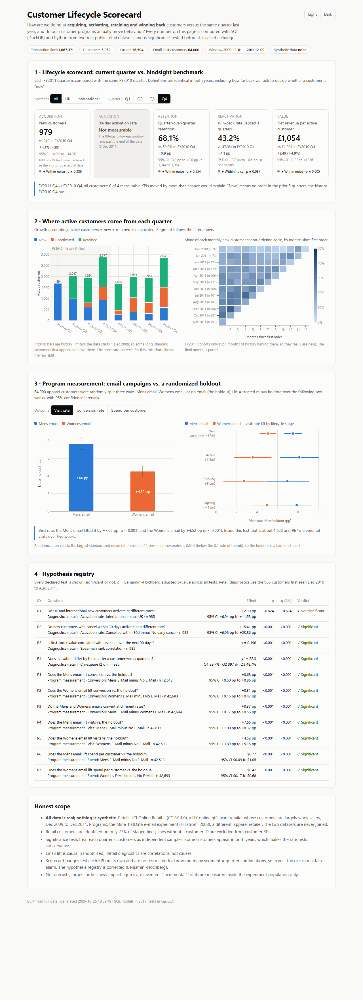

# Customer Lifecycle Scorecard

[](https://github.com/sreeyagalla/customer-lifecycle-analytics/actions/workflows/ci.yml)

**Live demo:** https://sreeyagalla.github.io/customer-lifecycle-analytics/



This is a one-page dashboard that answers two questions a customer analytics team gets asked all the time:

1. **How are we doing at acquiring, activating, retaining and winning back customers, compared with the same quarter last year?**
2. **Do our customer programs actually change behaviour, and by how much?**

Every number on the page is computed with SQL (DuckDB) and Python from two real, public retail datasets. A change is only called a change after a significance test.

## What it demonstrates

| Analyst task | Where it lives |
|---|---|
| Lifecycle KPIs across acquisition, activation, retention and reactivation | `sql/retail/05_customer_quarter.sql` gives every customer a lifecycle status for every quarter: new, retained, reactivated, lapsed or dormant |
| Comparing current performance against a hindsight benchmark | Scorecard: each FY2011 quarter vs. the same FY2010 quarter, with identical definitions in both years (`src/cla/analysis.py::scorecard`) |
| Measuring a customer program | Email campaigns vs. a randomized holdout: lift, 95% CIs, incremental totals and a randomization balance check |
| Diagnostics, correlations, hypothesis testing | A declared hypothesis registry (`config/hypotheses.yaml`) with two-proportion z-tests, Welch t-tests, a chi-square test, a Spearman correlation and Benjamini-Hochberg correction. Every test is reported, significant or not |
| Communicating with visuals | Static interactive dashboard (`docs/index.html`, Plotly.js) with segment, quarter and outcome filters, hosted on GitHub Pages |

## Data (all real, nothing synthetic)

| Dataset | What it is | Size used |
|---|---|---|
| [UCI Online Retail II](https://archive.ics.uci.edu/dataset/502/online+retail+ii) (CC BY 4.0) | Every invoice line of a UK online gift-ware retailer, 1 Dec 2009 to 9 Dec 2011. Many of its customers are wholesalers. | 1,067,371 published lines → 1,033,036 after cleaning → 36,594 orders from 5,852 identified customers |
| [MineThatData E-Mail Analytics](http://www.minethatdata.com/Kevin_Hillstrom_MineThatData_E-MailAnalytics_DataMiningChallenge_2008.03.20.csv) (Kevin Hillstrom, 2008) | 64,000 customers of an apparel retailer, randomly assigned to a Mens email, a Womens email or no email. Visits, conversions and spend were recorded over the next two weeks. | 64,000 customers (21,307 / 21,387 / 21,306) |

The two datasets come from different companies and are never joined. Both downloads are pinned by sha256. A 25% customer-level sample of the retail data (real rows, chosen by a sha256 hash rule) is committed in `data/sample/` so the tests run without the 45 MB download. The email CSV is downloaded, not committed.

Cleaning steps, each counted in `data_quality`:

- 22,523 lines removed because the workbook's two sheets both carry 1 to 9 Dec 2010.
- 11,812 exact duplicate lines removed.
- Fees, postage and adjustments excluded from revenue.
- Lines with no customer ID (23% of staged lines) left out of customer KPIs.

## Architecture

```
public files ──► cla fetch (sha256-pinned) ──► cla land (xlsx → parquet)
                                                    │
                                                    ▼
             DuckDB: sql/retail/01..08, sql/email/01   (staging → orders → customers →
                                                    │   customer × quarter lifecycle → marts)
                                                    ▼
             src/cla/analysis.py: scorecard, growth accounting, cohorts,
                                  program lift, hypothesis registry (scipy)
                                                    │
                                                    ▼
             docs/data.js ──► docs/index.html (static, Plotly.js) ──► GitHub Pages
```

## Key design decisions

- **Like-for-like "new customer" definition.** The data starts on 1 Dec 2009, so in FY2010 a long-standing customer can look new simply because their earlier orders predate the data. The scorecard defines "new" as *no order in the prior N quarters*, where N is the history the FY2010 benchmark quarter has, and applies the same N to FY2011. For FY2011 Q4 vs. FY2010 Q4, N = 3. For FY2011 Q4 the page also shows how many of those customers had never ordered at all (600 of 979).
- **"Not measurable" is reported as such.** A KPI whose benchmark has no history behind it (anything in FY2011 Q1) or whose 90-day follow-up runs past the end of the data (activation in FY2011 Q4) is shown as not measurable, with the reason, instead of a misleading number.
- **The strongest benchmark available.** Lifecycle KPIs can only use a hindsight benchmark (same quarter last year). The email programs have a randomized holdout, so their lift is causal. The largest standardized mean difference between arms on 11 pre-email covariates is 0.014.
- **Fiscal year runs Dec to Nov**, so the 24 complete months split into two complete years.
- **Static site instead of a server.** The analysis runs once in Python and writes `docs/data.js`. The page is plain HTML and JavaScript, so the live demo is free to host and loads instantly.

## What the data says (full dataset)

- **FY2011 Q4 vs. FY2010 Q4: no KPI moved beyond noise.** New customers were 979 vs. 940. Retention was 68.1% vs. 69.0%. Win-back was 43.2% vs. 47.3% (p = 0.087). Revenue per active customer was £1,054 vs. £1,004.
- **The one clear decline was FY2011 Q2 retention:** 56.8% vs. 62.4% a year earlier (−5.6 pp, p = 0.001).
- **Acquisition quarter matters.** Customers first seen in FY2011 Q1 (Dec to Feb) activated at 29.7%, against 48.7% for FY2011 Q3 (χ² p < 0.001, n = 985).
- **Both emails worked; the Mens email worked harder.**
  - Visits: +7.66 pp for Mens and +4.52 pp for Womens.
  - Conversion: +0.68 pp and +0.31 pp.
  - Spend per customer: +$0.77 and +$0.42.
  - Every one of these lifts is significant after BH correction.

## Tests

`pytest` runs 36 tests, all passing on the full data. In CI the 2 full-data tests skip and the rest run on the committed sample. The main checks:

- **SQL vs. an independent pandas implementation** (`tests/independent.py`): orders, customers, every customer-quarter lifecycle status, net revenue and activation flags must match row for row.
- **Every scorecard number on the live page vs. a recomputation from the raw file.** This covers all 60 scorecard rows (3 segments × 4 quarters × 5 KPIs), the growth chart counts and the email lift numbers.
- **The page has no hardcoded figures.** Every number in the page text is filled from `data.js`.
- **The statistics match reference implementations:** the two-proportion test and CI match statsmodels, Welch matches scipy, and BH matches statsmodels.
- The email arm sizes equal the published 21,307 / 21,387 / 21,306.

## Run it

```bash
python -m venv .venv && .venv/Scripts/activate      # or source .venv/bin/activate
pip install -e ".[dev]"
cla fetch            # both public files, sha256-verified
cla land             # workbook → parquet (~3 min)
cla all              # SQL build + docs/data.js  (or: cla fetch --only hillstrom && cla all --source sample)
pytest -q
python -m http.server -d docs 8000   # open http://localhost:8000
```

## Honest scope

- **Real vs. simulated:** everything is real public data. There are no synthetic records, targets, forecasts or invented business-impact figures. The "incremental" email totals (for example, about 1,632 extra visits from the Mens email) are measured inside the 64,000-customer experiment only.
- The retail data is a UK gift-ware wholesaler-heavy business and the email data is a different, apparel retailer. Findings describe those datasets, not any other company.
- The scorecard's significance badges test each KPI on its own and are not corrected for browsing many segment × quarter combinations: 4 of the 42 measurable comparisons flag at p < 0.05, about what chance alone would produce (2 expected). The hypothesis registry is corrected.
- The rate tests treat the two years' customers as independent samples. Some customers appear in both years, which makes the tests conservative.
- Retail diagnostics (the R hypotheses) are correlations, not causes. For example, the finding that customers who cancel early activate more often (52.5% vs. 37.1%) probably reflects wholesale order amendments, not a benefit of cancelling.
- No GenAI or LLM component, no paid APIs, and no BI-tool files (Tableau or Power BI): the visualization layer is the custom Plotly page.
